# v7 morning handoff

Pull request, unmerged: https://github.com/Pepper-pi/aro-webxr/pull/2

Acceptance commit: `3cdab504c8fdb2a5d9746f10df712698d707cca6` on `cursor/v7-mage-forearm-guide-6863`.

Live `/v7/` on main is unchanged. Nothing here was merged or deployed.

## Training yard ground (unpublished test)

The training yard, not the map and not a map raid, draws one continuous stone floor. The plates overlap so the idle gaps close, and cracks, pebbles, and a few wet marks stay on that stone. Landscape and far tiles use fewer marks. Wide short screens pack the yard buttons into a left rail and a right stack. The cast line sits left of the spell ring, not on it and not on the dodge. Dummy names keep their hit points. On a wide short screen they stack beside the posts, off the rings, the round banner, and the avatar. Portrait dodge buttons stay fully on screen. A bullet line is an incoming gun telegraph or the player's aim shot, not the item line. The cell drill is a reload cartridge, not a capture. Begin the day is the one playable loop: wake, walk to the dome, clear the raid, then the pond, bait, fish, home, and the night summary can be played again from a reload. The pond nodes say how many nodes are left. They are not wave 1 of 1. A wipe restores the wave and does not pay those drops a second time. The summary line is the pond fish. Creature capture is not in this loop. The hex grid underneath is the same one. While a cast is aimed, the selected hex and the cells that spell will hit light up before release. The standing hex, danger zones, and live field colors stay visible. A slash still cuts one hex at a time. Each risen cut shows its own lit interior, and fire or ice on that hex is the real field state. A negative hex index in the gully rubble used to throw and stop the rest of the cut from drawing; that index now wraps. Step, lava, ice, mob block, timer, and reset rules are unchanged. This was checked in Chrome on the desktop, not on a phone.

## Casting disc in first person

The training disc, including first person, draws the v3 mesh (5,020 triangles) when WebGL is available. Spell names and the charge percent stay drawn on top so the five game spells stay readable. The mesh itself has six gems, not those five names. If WebGL fails, the old sprite is still there.

The first composite looked like a dark plate because the old flat-disc fill was still painted on top of the mesh, covering the gold and the gems and leaving a thin arc. That fill is skipped when the mesh is showing. The metal is lit from above with a second fill so the ring is not a black silhouette. It is still not the Cycles picture.

The file does not contain a roughness number on the gold, so the page sets gold roughness to 0.22 and metal to 1 while drawing. That is not in the GLB. There are no textures. The charged halo in the Blender stills was not exported. The page brightens the mesh’s own glow with charge and adds a short soft fringe, not a plate over the floor. Clearcoat and transmission from the file are not shaded. The gold will look simpler than the Cycles picture.

## What you can do

- Mage: press the center, drag to aim, hold. **Full fires once** casts at full charge and the lift does not cast again. An early release is one weaker cast. Switching view, class, Reset, or Back drops the charge and does not cast. The forearm mark says **Not tracked**.
- Views: **Tactical** is the default. **Low** is an optional closer-to-the-floor arena camera (same aim math). **First person** is unchanged. Details are below.
- Gunner: holding does not fire. The shot happens on release.
- Slash cuts the hexes you aimed. The first step into a trench says to tap again, including when the fight clock is still 0. The next step enters. Ember on that trench is a lava seam and burns while you stand in it. Reset and the 14 second life both clear it. A mob that walks into the cut is stopped by the same obstacle check the arena uses.
- Training yard, Mage disc: Iceberg raises your wall at 90 HP. Ember aimed at that wall, on the glowing center, hits for **40** (full-charge power 1.65 × 12, weak point ×2). Three of those remove it. Frost and empty ground do not. A lift after the cast does not hit again. This 40 is the yard disc only.
- Map raid, Ember on the spell wheel, Tactical and Low: hold the field about a quarter second. The ring labels **Ice wall**, **Enemy**, or **Ground**. Release on your own wall to hit it. A hold of about a second is 19 damage, **38** on the center (power 1.6 × 12, weak point ×2). Three center holds go 90, then 52, then 14, then the wall shatters. A short tap is 12, or 24 on the center. Empty ground paints fire and does not hit the wall. A finger on a creature casts at that creature, even if the creature is standing on the wall. Frost and Honey do not use this aim. A fast swipe still steps. A second finger does not take the aim. A cancelled touch, a spell change, the Low button, Back, or a turn of the phone drops the press and the lift does not cast. The spell wheel and the dodge buttons stay. The training disc is not drawn in the map raid.
- Gel King bout is on the title. A full fight from 160 HP, without editing his health, can be won with Ember while stepping off red. One run of the test below did that in 7 casts.
- Raid: walk to the dome, **Enter the raid dome**, then tap the glass block. That punch starts the wave. **Back to the map** uses `endArena()` and returns to the map.

## Controls that stayed

Drag-to-aim, the 0.8 camera angle, disc charge, and the Gunner release rule were not retuned. `v7/regress.mjs` checks the angle is still 0.8 after these flows.

## Tests

From the repo, with the page already served at `http://127.0.0.1:8765/v7/` and Chrome available:

```
CHROME=/usr/local/bin/google-chrome node v7/regress.mjs
```

Three kinds of check live in that file. Do not treat them as the same thing.

- **Helper-level.** These call game functions. They do not move a finger. Mage early / full / lift / view-switch and the Gunner hold versus release go through `releaseDisc`, `releaseMage`, and `trainUpdate`. The training iceberg is the **40** center hit: 90 HP, three hits, shatter, frost and empty ground. That calls `releaseMage`. The trench step, mob block, lava burn, expiry, and reset call `moveP`, `mobObstacle`, and `slashLine`. The Gel King fight calls `releaseMage` from 160 HP. None of these call `wallHit` directly, and none of them are a finger on the raid canvas.
- **Mouse UI.** `raidWallPointer` enters from the map, punches the glass block, clicks Iceberg, and uses mouse down / move / up. It does not call `wallHit` or `releaseMage`. Tactical and Low, at 320×568, 390×844, and 844×390: a live enemy is on screen, empty ground leaves the wall at 90, a swipe steps, pointercancel does not hit, Frost on the wall does not damage it, the hold reports Ice wall, and Ember center holds deal **38** and shatter (90, 52, 14, gone). Layout checks at those three sizes still show the dummies and the player, and the page does not scroll.
- **Touch UI.** `raidTouch` uses Chrome's touch events (`Input.dispatchTouchEvent` with touch emulation). The page recorded `pointerType: "touch"` and a `touchstart`. This is not a physical phone. The same six raid views checked empty ground, a creature (the wall stayed at 90; the creature lost HP when the point landed on its sprite), a second finger, `touchcancel`, a spell-button press while a finger was down, and center holds of about a second. Those holds were **38** on the center and the wall shattered in every view. Turning the phone (390×844 to 844×390) and the Low button each dropped the press with the wall still at 90. In the yard, a touch on the disc followed by Reset or Back did not cast.

Last run of the whole file passed: helper checks, mouse UI, and touch UI together.

Touch flick, morning check. Chrome was delivering the flick: a straight 90px jump, on the back row and in the middle, with `pointerType: "touch"`. The game then refused to step whenever that jump arrived after about a quarter second, because the still-timer had already armed the aim ring. That is a game bug, not a missing event. A flick whose first real sample jumps more than 38px, and which has not already been dragged in small steps, now steps even if the ring had armed. A finger that rests and then drags through intermediate points still aims and does not step. After the fix, the touch suite's back-row flick stepped (q −1 to 0) and left the wall at 90 on Tactical and Low at 320×568, 390×844, and 844×390. Mouse flicks still step. Hold, cancel, spell change, and dodge still pass. A real iPhone is still worth a pass: this Chrome synthesizes the touch, and a hold followed by one very fast snap can step instead of casting.

## Pictures

Normal play, show-hold off, aim ring on dummy 2, trench in the row in front of the player:

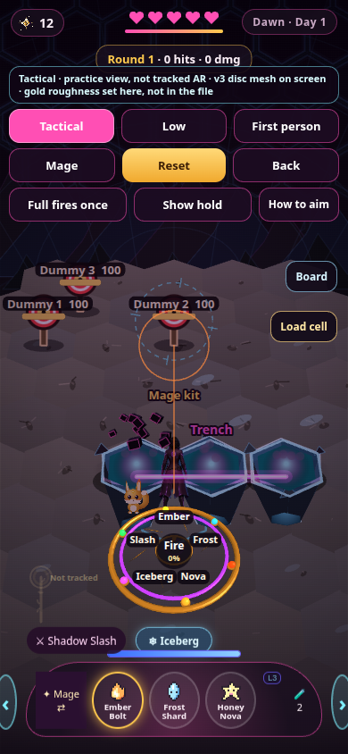

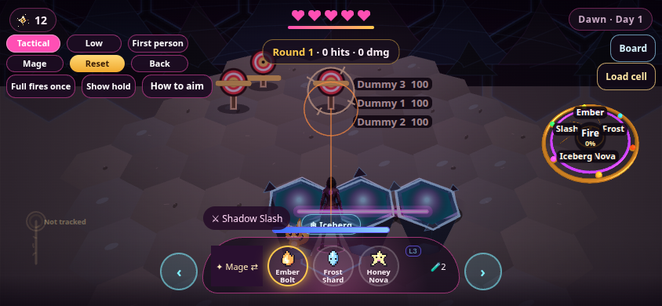

An earlier phone frame of a pit (`hole_trench_phone`) looked empty of people. Measured on 390×844, the dummies sit around y 349–387 and the player around y 523, which is below the button stack (ends ~248) and above the old cast line. The canvas sample for the new frame has a warm pixel on the dummy and a pixel on the player, so those sprites are being drawn. This note does not pick a single cause for the empty read.

## Layout fixes in this pass

- 320×568: the button stack covered all three dummies. Short portrait screens hide the note and use tighter buttons.
- Landscape: the side panel was half the screen and covered the dummies. It is 210px wide.
- The cast line sat on the player on a tall phone. It now sits at the left, under the buttons, and in the corner on short screens.
- The page already sets `overflow: hidden` and `touch-action: none` on the canvas, so the field does not scroll.

## Low angle (optional), including the map raid

Tactical stays the default at camera angle 0.8.

- Yard and Gel King: the view row is **Tactical**, **Low**, **First person**.
- Map raid: a **Low** button at the top right (it says **Low on** while that camera is up). It is not on the map. Entering a raid starts on Tactical. **Back to the map** hides that button and brings the map buttons back. The map’s own Home / Dome / Pond / Command row is hidden during the fight so it does not sit on the floor, and it returns when you are on the map again.

Low uses the same `proj` / `unproj` as Tactical, at angle 1.0. Plate edges are thicker, seam glow is lower, and the back of a raid is two ranges of dark rock rising from the horizon with a thin cyan or purple edge. While Low is on, a few dim streaks drift in that sky. They do not wet hexes and they are not a weather spell. On a cozy setting those streaks are skipped. The rocks are drawn once into the floor cache, not every frame.

A map raid checked in `v7/regress.mjs` starts at angle 0.8 with the Low button showing and the map row hidden, switches to angle 1 and back, then returns to the map with the map row visible.

Room-raid Ember aim, both cameras: hold the canvas with Ember selected. After about a quarter second the ring labels the point under your finger. Release on the wall to damage it. A fast swipe still changes hex and does not cast. The pictures below are that raid after a normal map enter, with a live slime and the player, then the ring on the wall, then the shatter. They are not a `wallHit` fixture.

The raid floor is drawn opaque. The hot-pink underworld used to show through the gaps between plates (default neon is 0.3, so the floor was partly see-through). Near seams stay cyan and far seams stay purple, which is the reference's restrained edge color rather than a pink bar. The red edge during a fight is the existing danger vignette, not a seam.

What this is not: the paintings’ wide canyon and huge cliffs. The pits stay one hex. The rocks are simple peaks, not a sculpted range. A steeper angle than 1.0 pushed side targets off the screen, so it was not kept.

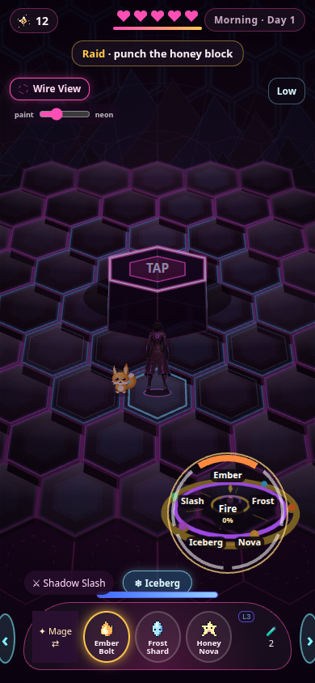

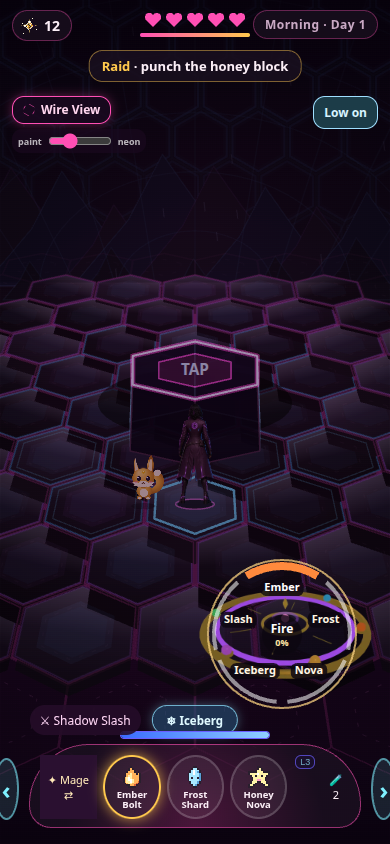

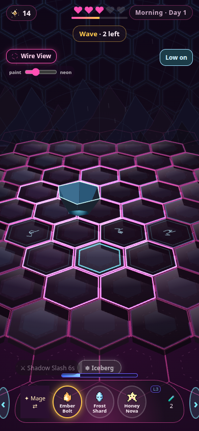

Same raid, before and after one back-row touch flick. The player steps one hex to the right. q went from −1 to 0.

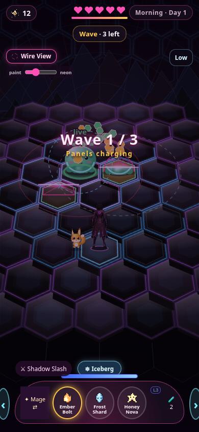

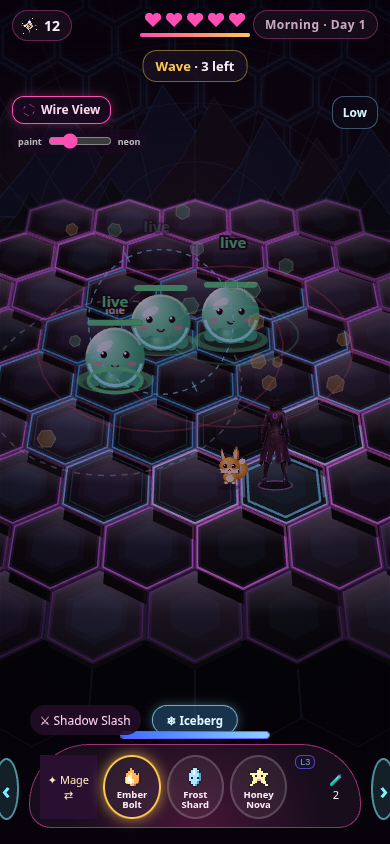

Ordinary map raid, before the wall. Player, fox, and a live slime:

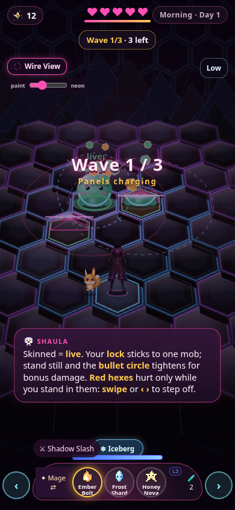

Hold on the wall. The ring says Ice wall:

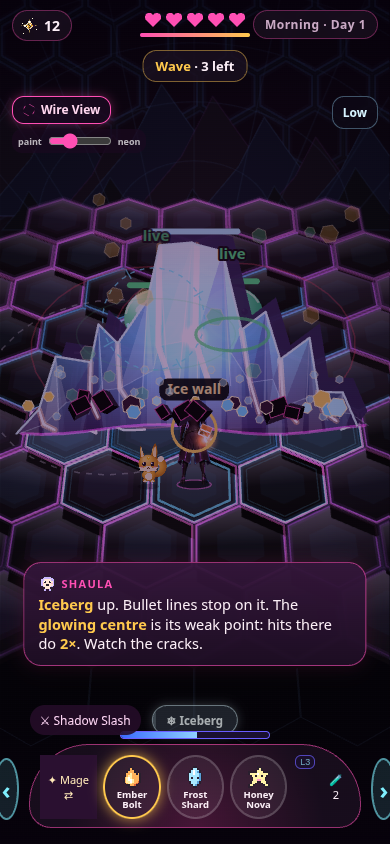

After the aimed Ember holds. Shattered, player and slime still there:

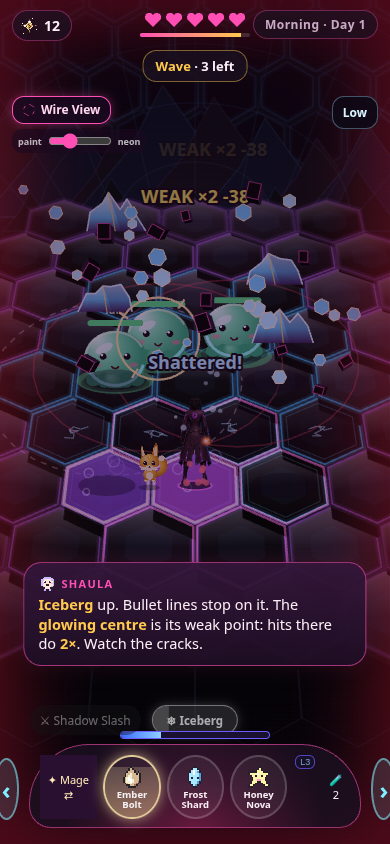

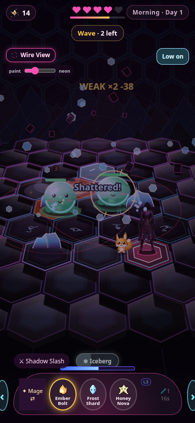

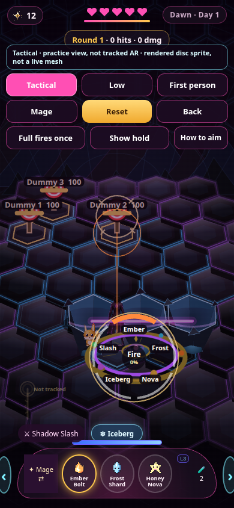

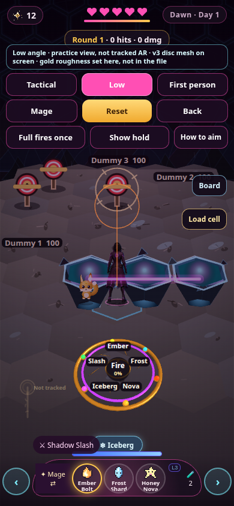

## What this acceptance changed

A second finger no longer replaces the press or fires it. The spell wheel, the Low button, Back, and a resize or turn of the phone drop the press, so the lift does not cast the old aim. `pointercancel` and `touchcancel` drop it too. The spell wheel and the dodge buttons are unchanged.

## Cell drill (training yard only)

One button on the right of the yard. **Load cell** arms a fire bolt from a dummy. **Kick cell** while it is in the air. The device skids under the dummy, opens, sends a beam up, snaps shut, and rattles. Then **Spend fire** (or water, electric, or aether if a test names that bolt) lights one lock and the same charge cannot be spent again. **Cancel** during the motion stores nothing. **Reset** clears the charge and the lock.

**Shape lock, Bryce, 4:52 PM PT on 2026-11-06.** This replaces the earlier note that three points versus four was unresolved. The device is a closed tetrahedron. All three side faces hinge on the central triangular base, open outward from the center, and drop into a three-point star. It is not the four-point concept and it is not an octahedron. The same three faces stay attached to the same three edges the whole way.

**Amendment, Bryce, 4:53 PM PT.** The faces settle a little past flat. The three outer tips stay on the field, and that props the central triangle up, the way a shallow trap sits. The lift comes only from that hinge angle. It does not bob, and nothing goes through the ground. On this camera, 24 degrees read as a tall tent and 12 degrees still read as a raised pyramid, so the yard uses 8 degrees. The center sits about a tenth of the way out to a point. `pastFlat` is not a locked number. The on-screen label **Finish provisional** is about the gold color only.

The yard button is the drill control. It is not on the spell wheel. While a bolt is in the air, a short flick on the field aims the skid and the avatar lunges that way. That is the kick. It is not a tracked foot. A small release does not kick, step, or cast. **Kick fallback** is the button for the same kick toward the nearest dummy. **Cancel**, **Reset**, and **Back** still drop the catch. Switching Tactical, Low, or First person keeps one stored charge. A missed bolt arms another attack and does not store a charge. After **Spent**, another load waits for Reset. `loadCell`, `startCellBolt`, `kickCell`, `cancelCell`, and `spendCell` are the calls a later item list can use. They do not know about a menu.

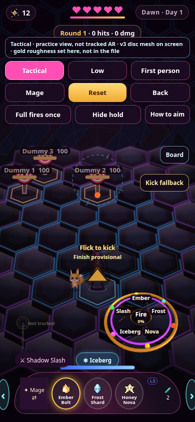

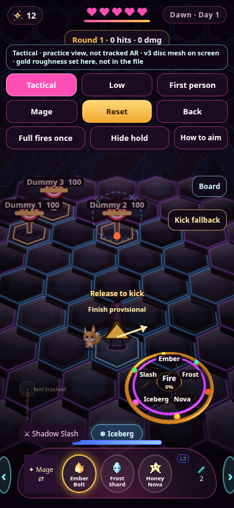

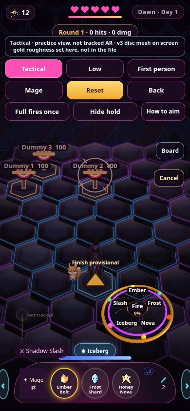

**Item line, Bryce, 5:23 PM PT, and the choice he left at 5:24 PM PT.** Cells belong on one ordered item line with potions, opened from the character command board, not the spell wheel. He said to decide the grab. The yard now does this: a screen button stands in for the bubble and is labeled **Not tracked**. Popping a potion calls the existing mana potion (one dose, +60 mana, 20 second cooldown). Popping a cell loads it and starts the incoming bolt. It does not kick. Kick stays the separate button. The lineup in the page is potion, then cell, then potion. That length is not a locked capacity, and nothing is saved.

A second tap uses the next item, not the same one again. If the mana potion is empty or cooling down, that pop does nothing and the line stays put. Reset and Back clear the cell. Back also drops the floating item. Changing view does not. The spell wheel does not pop the line.

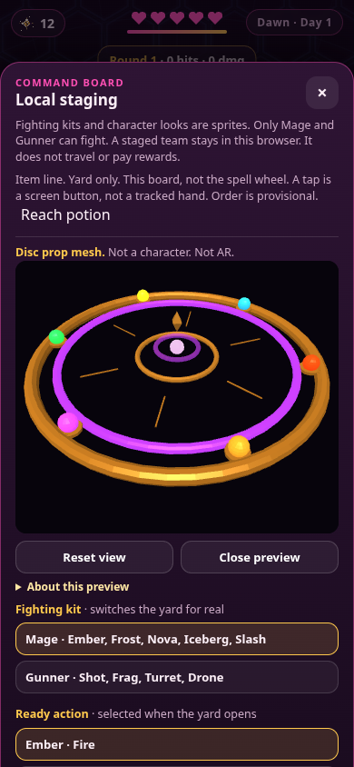

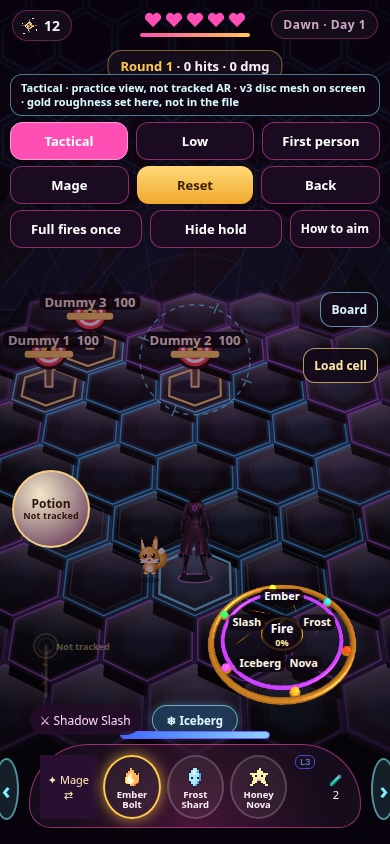

Those times are in `CELL_TUNABLE` and are not approved durations. The names fire, water, electric, and aether are the locked launch names. This is not pet capture. There is no inventory, ownership, HP gate, or boss rule. The rainbow siphon, floating diamond, and tether are not drawn.

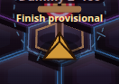

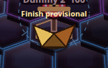

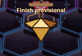

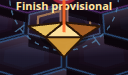

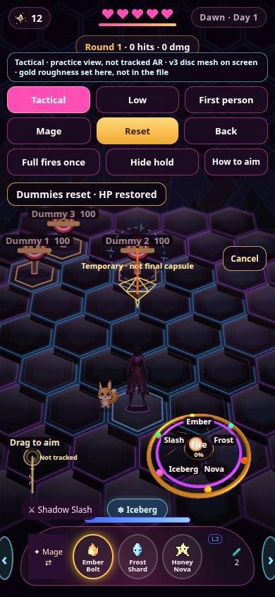

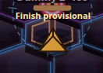

## Frame time (not a performance approval)

Headless Chrome 156 on this machine, one browser, no second page. The display is a 1920×1200 VNC at 60 Hz. There is no `/dev/dri`. WebGL reports ANGLE SwiftShader (Vulkan 1.3, Subzero). The game canvas is 2D. Device pixel ratio was 1, so 390×844 and 844×390 are the same number of pixels. RequestAnimationFrame gaps land on 16.7 ms ticks. A gap is the time until the next callback, not the JavaScript time inside it. Wrapping `heavyGrade`, `vignette`, `drawMap`, and `drawArena` showed under a millisecond of script in those functions. The rest is software raster and the work those wrappers do not cover.

The pond has no Tactical or Low camera. Those cameras exist on the yard and on a map raid. The morning isolated run (`profile-baseline.json`, 79 gaps after 25 warmup frames, two passes) had the yard near a 33 ms median, a map raid near 67 ms, the portrait pond near 67 ms, and the landscape pond near 117 ms with most frames over 100 ms. That run is kept. A later paired run on the same scenes was slower overall (the yard sat near 50 ms both before and after the change), so the before/after numbers below are the paired run, not the morning file compared with a later boot.

On that paired run the landscape pond was the outlier: median 166.7 ms, mean 170.7 ms, 74 of 79 frames over 100 ms, then the same scene again after the change at median 100 ms, mean 98.5 ms, 20 of 79 over 100 ms, then the old painter again at median 166.7 ms and mean 170.7 ms. Portrait pond moved from median 100 ms / mean about 104 ms to median 83.3 ms / mean 87.3 ms, and the old painter returned to median 100 ms. Yard tactical and low, both orientations, stayed on a 50 ms median. Map raid tactical and low stayed on about a 100 ms median. Turning the wire drawing off, on an earlier isolated pass, dropped the landscape pond from about 117 ms to about 33 ms. Turning the grade off left it near 100 ms. The grade is not the whole pond cost, and it was not rewritten. Raid did not have one function that accounted for its extra slot: dropping the grade, the mobs, the shimmer, or the seam one at a time left the median in place.

The change caches the still-camera plum field and the outer hex seam, and it skips inner dashes the opaque ground already covers. The seam bitmap is used only when 90 or more hexes are on screen. Landscape pond shows about 136. Portrait shows about 55, and a raid seam is about 61, where a full-canvas blit was slower than stroking them. One frozen pond frame against the old painter differed in 16,903 of 329,160 pixels: 16,413 by one level, 480 by two, 10 by three. Aim, hitboxes, timers, damage, and the CELL rules were not retuned. Nothing here is phone-ready, and this is not a performance pass. Commit `c921c8f`. On that commit `node v7/regress.mjs` passed, including rewards, rewind, CELL, aim, cancel, and own-wall. Its yard finish sample was 45 frames / 3056 ms, worst 450 ms. The threshold was not edited. Touch emulation, not a phone, finished the day at 390×844 and at 844×390, summary and replay title both up.

## Raid lattice

A still map raid was filling the screen and stroking the cyan lattice on every frame, under the floor plates. That lattice does not move with time, so it is now a bitmap until the camera changes. The training yard still paints its own stone and does not use this bitmap. One paired tactical landscape sample moved from a 100 ms median to 66.7 ms and back to 99.9 ms when the old stroke returned. The raw gaps for tactical and low, both orientations, are in the evidence for this commit. This is not a phone result and not an overall performance pass. The pond cache is unchanged.

## Original Gold

The title has an Original Gold button under the hint. It loads `v7/assets/Original_Gold_Likeness.glb` and checks sha256 `54b1f5c7bef848ab2ae364655296214e693e8f3aa196728d071a26413b5fd5aa` before drawing. The file is 118,790 triangles, 20 parts, 6 materials, no skeleton and no animation. Those base colors are linear. The preview encodes them for the screen and uses each material's roughness, specular factor, and clearcoat factor from the file. The colors are not repainted. Front, quarter, side, and back each draw that mesh once. The panel says it is loading the file before the first frame. A missing file or a bad hash shows that error, offers another try, and does not draw Boba there. Opening that preview does not change who you walk as.

Walk as Original Gold is a separate choice. After the hash check the page imports `v7/assets/original-gold-field-bake.mjs` and draws the same mesh three times into pictures (front, quarter, back). The frame is cleared transparent, not magenta. The readback is premultiplied and that script turns it into straight alpha, then the page crops it. The status line says it is preparing the field preview while that runs, and the walk button waits. A failed readback does not select her and does not draw Boba there. The recipe notes are `v7/assets/Original_Gold_field_recipe.json`. The page keeps the source hash, the view angles, and the picture hashes from that bake. Those picture hashes depend on the GPU. She then uses the existing map and raid picture slot: feet at the ground point, the same depth sort as the other pictures, a hop of the whole card, and the quarter picture mirrored when she walks toward screen-left. Raid still shows her back. A cast is a glow on that card. There is no skeleton and no transmission. The mesh is not drawn every frame. On this machine one view was about 120 ms and the three pictures together were about 1.0–1.5 s. A loop of `drawImage` calls is not a frame time.

The dock name moves to the open side, about at her hip, when she is standing on that hex. The house and the spawn hex stay put. On a short wide screen the coach card sits at the right, under the character button and clear of Home, Dome, the objective, and the spell row. The words are the same. Depth order of the world pictures is unchanged.

Wayfarer stays selected unless you pick Boba. The title cards stay Wayfarer and Boba art. Walk as Boba, or either race card, clears the field picture. Reload starts without it. Hitboxes, spells, CELL, items, and the day rewards are unchanged. This was checked in headless Chrome on SwiftShader, not on a phone.

## Short landscape title

At 844×390 the title block was taller than the frame, and the page body does not scroll. Gel King sat partly past the bottom and Open the map was fully past it. Short screens shrink the race cards and the title can be dragged. A later base rule was still centering that column, which put AETHER REALMS above the scrollport where a drag could not reach it. The short-screen rule now comes after that and packs from the top. Both logo lines are on screen with the four actions. The hint under them still scrolls into view. Portrait 390×844 is taller than this rule and was already fully on screen. The buttons do the same things.

## Outside combat, two buttons

On the map the persistent controls are **Menu** and the current action. The action is the existing one for that moment: step outside, walk to the dome, enter the raid, walk to the pond, face the guard, open the Cook Nook, cast, fly home, or rest. Combat still uses the spell wheel, the dodge buttons, and the Low button. Menu does not take presses there.

Menu opens the existing hex panel. The tiles keep the chibi icons. Bag, the Cook Nook, and Fishing are the focused screens. The Cook Nook is the crafting screen already in the day. There is no second kitchen. Fishing opens the pond cast only after the Cook Nook step. Before that, the tile says so and does not start a cast. Bag, the Cook Nook, Fishing, and Settings have Back and Home. Both return to this menu. They do not walk you home. The map's own Home button still walks to the house. Cooking is the Cook Nook craft screen. There is no second kitchen. The raid, the pond hack, rewards, the cell drill, and Reset are unchanged. The map's Home, Dome, Pond, and Command row is still there. While the menu is open, the action button does not take a press. Escape closes the top screen and returns to Menu.

The glass and ground boards shipped on 2026-11-07 are offline composites of the 55fc1d5 map, not runtime proof. Owner lock is the two buttons, the hex menu, the real Bag / Cook Nook / Fishing screens, and the chibi icons. Colors, pixel sizes, contrast samples, and the recessed-slate look are proposals. The glass board's empty lower half and the controls drawn under it are faults in that composite, not a layout to copy. Its symbols are provisional and are not in the game. Cooking is not a second screen. Settings in the game are Sound, Cozy mode, Haptics, Floor look, Map tilt, and Spell hand, saved on this device as `aro7set`. The ground art is not in the game. The November 7 unlit texture was tried in the raid cache and taken back out. See the ground trial note below.

## Simulated map markers

This map is the existing hex field. It is not a phone location and it does not ask for one. The dock name moves aside when it would cover the avatar, the hive, a toast, or the objective. Names for the forest, meadow, and stone marks are drawn on a dark plate after the trees, and only when that mark's own center is on screen and clear of the buttons. When a mark's center is off the screen, at most two nearest names are repeated at the safe edge with a chevron pointing at the real cell. The name plate and the chevron both stay 14px inside the frame, and the chevron is painted after the grade so it stays light. Duplicate Forest names are not repeated. If the edge has no free spot, that name is left off. The dock name uses the earlier right-side spot again. The closed portrait still has to be checked against the avatar before calling the map clean.

The menu sits on one upright pink hex with a visible edge and one inner seam. That sheet quiets the map behind the whole menu. Outside it, the world stays. The tabs are cyan and violet glass with white marks, staggered along the left edge. The section pane is a smaller hex on the right and it scrolls. Landscape shows all seven tabs. Portrait labels stay 16px. Changing a setting paints that control immediately. The world action and the world menu button stay hidden while the menu is open. Each tab mark is a small flat frost silhouette. A pane-colored glow sits behind the shape, and the hex center stays a light tint so the map shows through the rim. The fishing reason is written in the pane beside the rail, not inside the tab. The seven sections are Bag, Nook, Fishing, Spellbook, Collection, Settings, and Command. Their actions are unchanged. At text zoom 2 the rail becomes a Sections drawer inside the menu. In the ordinary just-stepped-outside view the portrait centers for both forests and the meadow are off the sides, so the nearer Forest and the Meadow get edge chevrons. The stone center sits in the bottom control band and is not given a second label. In landscape those forest and meadow names stay on their cells, and the stone center is below the frame with no free edge slot, so it is not labeled. The camera was not moved. Glass marks name the forest, meadow, and stone clusters that were already generated. Home, the raid dome, the pond spot, the hive, and the crops stay solid. Decorative trees are dropped beside you and beside today's route, and they gather toward the outer grass. Walking, water, and spawns are unchanged. `window.__noHolo` only exists so a paired frame sample can turn the rings and the fade off. It is not a setting.

## Ground texture trial, not kept

`ground_unlit_srgb_256.png` from the November 7 kit, sha256 `e18457cb3f0b0473d69e3ed52cb9fd904722ded7e00023483392085419fd12a2`. It is the same file as the albedo. RGB, 256 square. Measured pixels sit between 19 and 38. Opposite edges match. It was stamped once into the existing raid floor cache, clipped to the hexes that are already drawn, with the pattern lined up from world `(0,0)` across six cell widths. The hex seams were stroked after it. The map, the training-yard stone, and the pond hack were not filled. The wall panel and the emissive mask were not loaded. The mask was not stretched. There is no bloom pass.

A restrained soft-light at 0.45 darkened plates that are already near that navy and did not leave a pattern you can see. Painting the texture at full strength flattened the face shading that separates the hexes. The fire mark and the Low camera still drew on top, so readability of those cues was not the failure. The failure is the texture itself at its real values. Cache rebuilds on this machine, landscape raid, 15 calls: median 0.7 ms without the stamp and 0.5 ms with it. Cost was not the reason it came out. The picture is not in the repo.

The floor is Canvas 2D. There is no material slot, no mip chain, and no per-hex UV. One repeat is an affine fit of the perspective camera, so the far edge is not perspective-correct. Field colors, danger marks, and the avatar paint after the cache. The map uses a different cache.

## Cozy reel

Ordinary fishing is the old reel again. Three beats, two hits land the fish, a miss uses up that beat, and fewer than two hits lets it go. The score still uses how many hits you made. Bait is still spent only on a landing. Cozy mode still only widens the window a little. It does not guarantee the catch. That guarantee would change who escapes and which score you get, and it is left as an owner choice. `?reelproto=1` is an unpublished page flag, not a setting. It is the only place a miss retries the same beat and Reel assist can finish those three hits. `STILLBLOOM_AR.md` is not in this checkout. There is still no minute-long wait.

Outside combat the persistent controls are Menu and the current action. The hex tiles sit on a dark glass plate sized to those tiles, with a light rim. Home, Dome, Pond, Command, Wire View, the character button, and the paint slider are not on that screen. The tutorial and the objective line are hidden while the plate is open. A tap on the map behind it does not walk. Closing a sheet by clearing its open flag, which the command board test does, releases the action button again. A closed sheet is not visible and its buttons are not focusable. Settings and the Bag keep Back and Home, and both return to the plate. They do not walk you home. The six settings and the chibi tiles are unchanged. The rejected ground texture stays out. The rejected ground texture stays out.

## Still open

- No phone in hand. iOS Safari can cancel a touch on rotation at a different moment than this Chrome. The events here were synthesized touches, and they did arrive as `pointerType: "touch"`.
- Frame time above is SwiftShader in headless Chrome. A phone GPU was not measured.
- Pepper reported a slime-area candy name, Godstoppers. That is a reported design name only. It is not a rule and it does nothing in the game.
- A touch flick that Chrome delivered as one late 90px jump now steps. Confirmed in the touch suite at all three sizes and both cameras. A phone in hand has not been tried.
- If a creature is standing on the center of the wall, the ring says Enemy and the cast hits the creature. Aim a clear part of the wall to get the 38.
- Frost and Honey do not shatter a wall. The yard's 40 and the raid's 38 are different holds. Do not mix them.
- The pits are still one hex deep. The rocks are simple peaks. No tracked hand, no walking slime, no characters from the paintings. Root `index.html` and `v6/` are unchanged. Not merged. Not deployed.
- A map raid is Morning. Night is the flight home and the day summary, and the raid painter does not use that clock. Entering the raid places one rock on the left front hex, a two-section rock farther left, and one ice block. Ember aimed at a section can break that section only. A creature under the finger still comes first. A broken section can drop a bounded piece of the same material, and that piece does not drop another.
