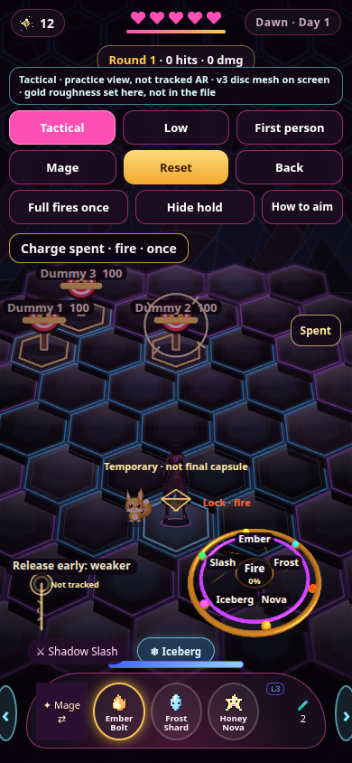

# v7 morning handoff

Pull request, unmerged: https://github.com/Pepper-pi/aro-webxr/pull/2

Acceptance commit: `3cdab504c8fdb2a5d9746f10df712698d707cca6` on `cursor/v7-mage-forearm-guide-6863`.

Live `/v7/` on main is unchanged. Nothing here was merged or deployed.

## Casting disc in first person

The training disc, including first person, draws the v3 mesh (5,020 triangles) when WebGL is available. Spell names and the charge percent stay drawn on top so the five game spells stay readable. The mesh itself has six gems, not those five names. If WebGL fails, the old sprite is still there.

The first composite looked like a dark plate because the old flat-disc fill was still painted on top of the mesh, covering the gold and the gems and leaving a thin arc. That fill is skipped when the mesh is showing. The metal is lit from above with a second fill so the ring is not a black silhouette. It is still not the Cycles picture.

The file does not contain a roughness number on the gold, so the page sets gold roughness to 0.22 and metal to 1 while drawing. That is not in the GLB. There are no textures. The charged halo in the Blender stills was not exported. The page brightens the mesh’s own glow with charge and adds a short soft fringe, not a plate over the floor. Clearcoat and transmission from the file are not shaded. The gold will look simpler than the Cycles picture.

## What you can do

- Mage: press the center, drag to aim, hold. **Full fires once** casts at full charge and the lift does not cast again. An early release is one weaker cast. Switching view, class, Reset, or Back drops the charge and does not cast. The forearm mark says **Not tracked**.
- Views: **Tactical** is the default. **Low** is an optional closer-to-the-floor arena camera (same aim math). **First person** is unchanged. Details are below.
- Gunner: holding does not fire. The shot happens on release.
- Slash cuts the hexes you aimed. The first step into a trench says to tap again, including when the fight clock is still 0. The next step enters. Ember on that trench is a lava seam and burns while you stand in it. Reset and the 14 second life both clear it. A mob that walks into the cut is stopped by the same obstacle check the arena uses.
- Training yard, Mage disc: Iceberg raises your wall at 90 HP. Ember aimed at that wall, on the glowing center, hits for **40** (full-charge power 1.65 × 12, weak point ×2). Three of those remove it. Frost and empty ground do not. A lift after the cast does not hit again. This 40 is the yard disc only.
- Map raid, Ember on the spell wheel, Tactical and Low: hold the field about a quarter second. The ring labels **Ice wall**, **Enemy**, or **Ground**. Release on your own wall to hit it. A hold of about a second is 19 damage, **38** on the center (power 1.6 × 12, weak point ×2). Three center holds go 90, then 52, then 14, then the wall shatters. A short tap is 12, or 24 on the center. Empty ground paints fire and does not hit the wall. A finger on a creature casts at that creature, even if the creature is standing on the wall. Frost and Honey do not use this aim. A fast swipe still steps. A second finger does not take the aim. A cancelled touch, a spell change, the Low button, Back, or a turn of the phone drops the press and the lift does not cast. The spell wheel and the dodge buttons stay. The training disc is not drawn in the map raid.
- Gel King bout is on the title. A full fight from 160 HP, without editing his health, can be won with Ember while stepping off red. One run of the test below did that in 7 casts.
- Raid: walk to the dome, **Enter the raid dome**, then tap the glass block. That punch starts the wave. **Back to the map** uses `endArena()` and returns to the map.

## Controls that stayed

Drag-to-aim, the 0.8 camera angle, disc charge, and the Gunner release rule were not retuned. `v7/regress.mjs` checks the angle is still 0.8 after these flows.

## Tests

From the repo, with the page already served at `http://127.0.0.1:8765/v7/` and Chrome available:

```
CHROME=/usr/local/bin/google-chrome node v7/regress.mjs
```

Three kinds of check live in that file. Do not treat them as the same thing.

- **Helper-level.** These call game functions. They do not move a finger. Mage early / full / lift / view-switch and the Gunner hold versus release go through `releaseDisc`, `releaseMage`, and `trainUpdate`. The training iceberg is the **40** center hit: 90 HP, three hits, shatter, frost and empty ground. That calls `releaseMage`. The trench step, mob block, lava burn, expiry, and reset call `moveP`, `mobObstacle`, and `slashLine`. The Gel King fight calls `releaseMage` from 160 HP. None of these call `wallHit` directly, and none of them are a finger on the raid canvas.
- **Mouse UI.** `raidWallPointer` enters from the map, punches the glass block, clicks Iceberg, and uses mouse down / move / up. It does not call `wallHit` or `releaseMage`. Tactical and Low, at 320×568, 390×844, and 844×390: a live enemy is on screen, empty ground leaves the wall at 90, a swipe steps, pointercancel does not hit, Frost on the wall does not damage it, the hold reports Ice wall, and Ember center holds deal **38** and shatter (90, 52, 14, gone). Layout checks at those three sizes still show the dummies and the player, and the page does not scroll.
- **Touch UI.** `raidTouch` uses Chrome's touch events (`Input.dispatchTouchEvent` with touch emulation). The page recorded `pointerType: "touch"` and a `touchstart`. This is not a physical phone. The same six raid views checked empty ground, a creature (the wall stayed at 90; the creature lost HP when the point landed on its sprite), a second finger, `touchcancel`, a spell-button press while a finger was down, and center holds of about a second. Those holds were **38** on the center and the wall shattered in every view. Turning the phone (390×844 to 844×390) and the Low button each dropped the press with the wall still at 90. In the yard, a touch on the disc followed by Reset or Back did not cast.

Last run of the whole file passed: helper checks, mouse UI, and touch UI together.

Touch flick, morning check. Chrome was delivering the flick: a straight 90px jump, on the back row and in the middle, with `pointerType: "touch"`. The game then refused to step whenever that jump arrived after about a quarter second, because the still-timer had already armed the aim ring. That is a game bug, not a missing event. A flick whose first real sample jumps more than 38px, and which has not already been dragged in small steps, now steps even if the ring had armed. A finger that rests and then drags through intermediate points still aims and does not step. After the fix, the touch suite's back-row flick stepped (q −1 to 0) and left the wall at 90 on Tactical and Low at 320×568, 390×844, and 844×390. Mouse flicks still step. Hold, cancel, spell change, and dodge still pass. A real iPhone is still worth a pass: this Chrome synthesizes the touch, and a hold followed by one very fast snap can step instead of casting.

## Pictures

Normal play, show-hold off, aim ring on dummy 2, trench in the row in front of the player:


An earlier phone frame of a pit (`hole_trench_phone`) looked empty of people. Measured on 390×844, the dummies sit around y 349–387 and the player around y 523, which is below the button stack (ends ~248) and above the old cast line. The canvas sample for the new frame has a warm pixel on the dummy and a pixel on the player, so those sprites are being drawn. This note does not pick a single cause for the empty read.

## Layout fixes in this pass

- 320×568: the button stack covered all three dummies. Short portrait screens hide the note and use tighter buttons.
- Landscape: the side panel was half the screen and covered the dummies. It is 210px wide.
- The cast line sat on the player on a tall phone. It now sits at the left, under the buttons, and in the corner on short screens.
- The page already sets `overflow: hidden` and `touch-action: none` on the canvas, so the field does not scroll.

## Low angle (optional), including the map raid

Tactical stays the default at camera angle 0.8.

- Yard and Gel King: the view row is **Tactical**, **Low**, **First person**.
- Map raid: a **Low** button at the top right (it says **Low on** while that camera is up). It is not on the map. Entering a raid starts on Tactical. **Back to the map** hides that button and brings the map buttons back. The map’s own Home / Dome / Pond / Command row is hidden during the fight so it does not sit on the floor, and it returns when you are on the map again.

Low uses the same `proj` / `unproj` as Tactical, at angle 1.0. Plate edges are thicker, seam glow is lower, and the back of a raid is two ranges of dark rock rising from the horizon with a thin cyan or purple edge. While Low is on, a few dim streaks drift in that sky. They do not wet hexes and they are not a weather spell. On a cozy setting those streaks are skipped. The rocks are drawn once into the floor cache, not every frame.

A map raid checked in `v7/regress.mjs` starts at angle 0.8 with the Low button showing and the map row hidden, switches to angle 1 and back, then returns to the map with the map row visible.

Room-raid Ember aim, both cameras: hold the canvas with Ember selected. After about a quarter second the ring labels the point under your finger. Release on the wall to damage it. A fast swipe still changes hex and does not cast. The pictures below are that raid after a normal map enter, with a live slime and the player, then the ring on the wall, then the shatter. They are not a `wallHit` fixture.

The raid floor is drawn opaque. The hot-pink underworld used to show through the gaps between plates (default neon is 0.3, so the floor was partly see-through). Near seams stay cyan and far seams stay purple, which is the reference's restrained edge color rather than a pink bar. The red edge during a fight is the existing danger vignette, not a seam.

What this is not: the paintings’ wide canyon and huge cliffs. The pits stay one hex. The rocks are simple peaks, not a sculpted range. A steeper angle than 1.0 pushed side targets off the screen, so it was not kept.


Same raid, before and after one back-row touch flick. The player steps one hex to the right. q went from −1 to 0.


Ordinary map raid, before the wall. Player, fox, and a live slime:


Hold on the wall. The ring says Ice wall:


After the aimed Ember holds. Shattered, player and slime still there:


## What this acceptance changed

A second finger no longer replaces the press or fires it. The spell wheel, the Low button, Back, and a resize or turn of the phone drop the press, so the lift does not cast the old aim. `pointercancel` and `touchcancel` drop it too. The spell wheel and the dodge buttons are unchanged.

## Cell drill (training yard only)

One button on the right of the yard. **Load cell** arms a fire bolt from a dummy. **Kick cell** while it is in the air. The temporary tetrahedron skids under the dummy, folds flat, sends a beam up, snaps shut, and rattles. The label on it says **Temporary · not final capsule**. Then **Spend fire** (or water, electric, or aether if a test names that bolt) lights one lock and the same charge cannot be spent again. **Cancel** during the motion stores nothing. **Reset** clears the charge and the lock.

Those times are in `CELL_TUNABLE` and are not approved durations. The names fire, water, electric, and aether are the locked launch names. This is not pet capture. There is no inventory, ownership, HP gate, or boss rule. The rainbow siphon, floating diamond, and tether are not drawn. Whether the real capsule opens on three points or four is still unresolved, so this tetrahedron is a placeholder that can be swapped.




## Still open

- No phone in hand. iOS Safari can cancel a touch on rotation at a different moment than this Chrome. The events here were synthesized touches, and they did arrive as `pointerType: "touch"`.
- A touch flick that Chrome delivered as one late 90px jump now steps. Confirmed in the touch suite at all three sizes and both cameras. A phone in hand has not been tried.
- If a creature is standing on the center of the wall, the ring says Enemy and the cast hits the creature. Aim a clear part of the wall to get the 38.
- Frost and Honey do not shatter a wall. The yard's 40 and the raid's 38 are different holds. Do not mix them.
- The pits are still one hex deep. The rocks are simple peaks. No tracked hand, no walking slime, no characters from the paintings. Root `index.html` and `v6/` are unchanged. Not merged. Not deployed.
